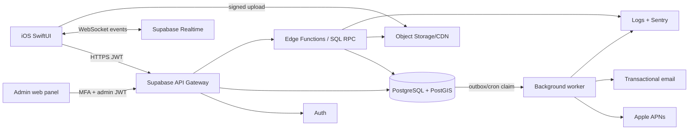
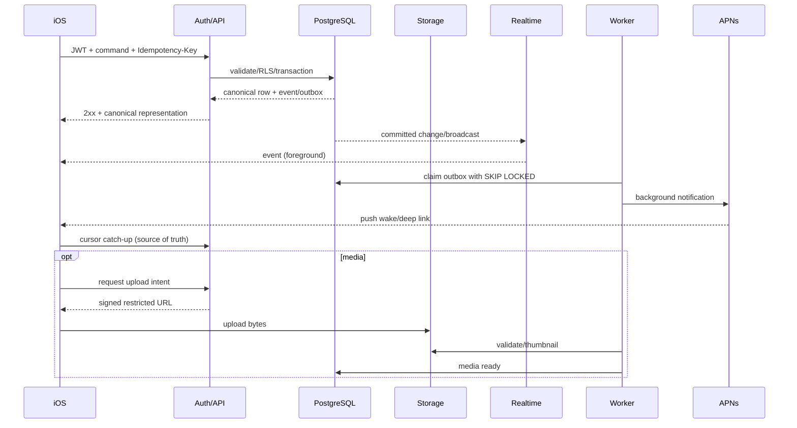

# Системна архітектура

## Вибір підходу

| Варіант | MVP/вартість | Realtime/data model | Lock-in/hosting | Висновок |
|---|---|---|---|---|
| Supabase | найкоротший шлях; Pro від $25 | PostgreSQL/PostGIS, RLS, Storage, Realtime | середній; DB/SQL portable, Auth/Realtime adapters ні; self-hostable | **Основний** |
| Firebase | сильні iOS SDK/offline/FCM; usage billing | Firestore денормалізація, per-read/listener billing; geo й реляційні правила складніші | високий; Google-managed | Добрий mobile BaaS, але гірше для цього graph/geo домену |
| NestJS + PostgreSQL | більше build/ops cost | повний контроль, WebSockets/jobs | низький lock-in; будь-який container host | **Альтернатива/еволюція** |
| FastAPI + PostgreSQL | швидкий API, Python ecosystem | аналогічно custom backend | низький | Валідний, але NestJS краще об'єднує typed contracts/WS/queues для TS-команди |
| Hybrid | BaaS + custom commands | найкращий баланс | контрольована залежність | Обрана форма Supabase architecture |

Firebase free quota включає 1 GiB і 50k reads/20k writes на день, але realtime listeners тарифікують document reads/reconnects: [Firestore pricing](https://firebase.google.com/docs/firestore/pricing). Це робить chat/feed cost model менш передбачуваним.

## Контекстна діаграма

Немає окремого API Gateway продукту: Supabase gateway + versioned Edge Function routes є спрощеною альтернативою. Прості read queries використовують views/RLS; команди з кількома writes — RPC/Function.

## Data flow

## Модулі модульного моноліту

| Модуль | Відповідальність / правила | Залежності / async | Scale/test focus |
|---|---|---|---|
| Identity | provider identities, account status, sessions | Auth → profile bootstrap | enumeration, revoke, replay |
| Profiles | public/private projections, settings/interests/photos | Media, privacy | field-level RLS |
| Discover | eligible candidates, filters, impressions/actions | Profiles, blocks, PostGIS | geo index, stable cursor |
| Social | posts, recipes, workout updates, comments, likes/saves | Media, moderation | fan-out-on-read, keyset |
| Messaging | conversation membership, messages, reads | Realtime, media, notifications | idempotency, ordering, reconnect |
| Fitness | sessions, participants, invitations | Messaging, notifications | state machine/races/timezones |
| Media | upload intents, objects, variants, lifecycle | Storage, moderation | MIME/bomb/quota |
| Notifications | in-app notifications, preferences, APNs devices/outbox | all event producers | dedupe/retry/token invalidation |
| Safety | blocks, reports, hides, moderation cases/actions | all queries | deny-first integration tests |
| Admin | least-privilege operations and audit | Safety, analytics | MFA/role separation |
| Jobs | outbox delivery, thumbnails, reminders, deletion/export | DB/Storage/APNs | at-least-once/idempotent |
| Observability | correlation IDs, logs, metrics, alerts | all | PII redaction/SLOs |

## Бізнес-правила, помилки та edge cases

- DB — canonical source; realtime/push ніколи не є джерелом істини.
- Every resource query applies active-account, membership/ownership, visibility and block predicates.
- Commands accept idempotency key; duplicate with same payload returns original result, different payload → `409 IDEMPOTENCY_CONFLICT`.
- Optimistic concurrency uses `version`/`updated_at`; stale mutation → `409 VERSION_CONFLICT`.
- Multi-row transitions run in one transaction and lock aggregate row.
- External side effects use transactional outbox; worker retries with backoff/dead-letter.
- Errors follow `application/problem+json`; no provider/internal identifiers exposed.

## Повний module contract checklist

Ця матриця є стислим контрактом за 12 обов'язковими аспектами; детальні endpoints/таблиці/тести рознесені у відповідні документи.

| Module | Purpose / responsibility / business rules | Data + API | Dependencies + events | Access / errors / edge cases | Tests / scaling |
|---|---|---|---|---|---|
| Auth | establish identity, rotate/revoke sessions, account-state gate | Auth identities, profiles; managed OAuth + `/me/bootstrap` | Apple/Auth; `user.created`, `account.disabled` | own session only; neutral errors; callback/reinstall races | nonce/reuse/enumeration; provider limits |
| Users/Profile | canonical private record and safe public projection | profiles/settings/interests/photos; `/me/*`, `/profiles/{id}` | Auth/Media/Safety; `profile.updated` | O write, V read; version conflict, incomplete/deleted | RLS field matrix; indexed public lookup |
| Discover/Matching | eligible nearby candidates and actions | locations/relationships; `/discover`, actions | Profile/PostGIS/Safety/Chat; `connection.created` | never exact location; stale point, no candidates, repeated pass | geo explain/leak tests; keyset/candidate cache |
| Feed/Posts | durable typed publishing and eligible feed | posts/subtypes/interactions; `/feed`, `/posts*` | Profile/Media/Safety; `post.published` | author mutations, V reads; media pending/edit race | ranking/RLS/load; materialize only if measured |
| Recipes | validate and render recipe subtype atomically | recipes/ingredients/steps through post API | Posts/Media | inherits post policy; ordered duplicates/nutrition bounds | aggregate transaction; batch eager-load |
| Workouts/Sessions | plan attendance and invitations with capacity | sessions/participants/invitations; `/workout-*` | Profile/Chat/Notifications; status events | creator/invitee transitions; DST/full/cancel races | concurrent seats/timezone; row-lock aggregate |
| Chat/Messaging | durable ordered 1:1 messaging | conversations/members/messages/reads; `/conversations*` | Auth/Safety/Media/RT/Push; message events | M only; duplicate, gap, reconnect, block race | sequence/idempotency/socket load; partition later |
| Media | authorize, validate, transform and expire objects | media_objects; upload-intent/complete/signed-read | Storage/worker/Safety; `media.ready|rejected` | owner/parent visibility; spoofed MIME/orphan/quota | malicious corpus; CDN/lifecycle metrics |
| Notifications | in-app truth plus best-effort APNs | notifications/devices/outbox; `/notifications`, `/push-devices` | all domains/APNs; domain events | O read; invalid token/quiet hours/dedupe | provider simulations; worker horizontal scale |
| Search | visibility-safe people/post/recipe lookup | tsvector/trigram views; `/search` | Profile/Posts/Safety | apply visibility first; short query/scraping | explain/load/relevance; external engine only on evidence |
| Moderation | report intake, cases, sanctions and appeals | reports/cases/actions/audit; `/reports`, `/admin/*` | all resources/Admin/Notifications | reporter + scoped A; evidence/duplicate/emergency access | role/evidence/audit tests; queue workers |
| Admin | least-privilege operational UI/API | admin roles and audited commands | Moderation/Observability | MFA/case scope; never free-read chat/location | RBAC negative tests; separate deployment |
| Background Jobs | reliable external side effects and lifecycle work | outbox/leases/dead-letter | DB/APNs/Storage/Email | S only; retry poison/lease loss | idempotent replay/chaos; scale consumers |
| Analytics | privacy-minimized product/operational signals | append-only pseudonymous events/aggregates | all domains/consent | no message/location payload; opt-out/deletion | schema/PII scans; batch export when needed |
| Monitoring/Logging | detect SLO/security/cost regressions | logs/metrics/traces/alerts | all services | staff scoped; redact secrets/PII; outage/backpressure | synthetic canaries; sampling/retention scale |

## Deployment topology

Dev: local Supabase stack; staging and production: separate projects, keys and APNs environments. SQL migration is the only schema path. Admin is a separate web app/domain. Details: [13-DEVOPS-INFRASTRUCTURE.md](13-DEVOPS-INFRASTRUCTURE.md).

## Evolution triggers

Extract NestJS only when: domain functions exceed Edge runtime limits; >2.5k realtime events/s or custom delivery protocol; complex moderation/jobs need durable queue; DB CPU p95 >70% after query/index optimization; or team requires provider portability. Extract modules one bounded context at a time behind the same `/v1` contract.
