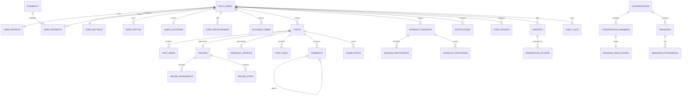

# Database design

## Conventions

PostgreSQL 17-compatible SQL; `uuid` PK generated server-side; `timestamptz` UTC; snake_case; money absent; mutable aggregates have `version bigint`; public identifiers are opaque. `created_at`, `updated_at`, optional `deleted_at`; `citext`, `pgcrypto`, `postgis`, `pg_trgm`. All user-facing list endpoints use keyset cursors `(sort_value,id)`, never offset.

## ERD



## Каталог таблиць

Позначення policy: O=owner; M=conversation/session member; V=visible after privacy+block filters; S=service role; A=admin role with case scope.

| Table | Ключові поля і constraints | Індекси / delete / lifecycle / policy |
|---|---|---|
| `user_profiles` | `user_id PK FK auth.users`, `public_code unique`, `display_name`, `birth_date`, `gender_code`, `bio`, `experience_level check`, `home_gym_id FK`, `preferred_time`, `visibility`, `onboarding_state`, `version` | trigram name; soft delete; O write, V read |
| `user_settings` | `user_id PK`, radius 1..100, discovery/push/privacy flags, locale/timezone | O only; retained until account erasure |
| `interests` | `id`, `slug unique`, `label`, `active` | public read; admin write |
| `user_interests` | `(user_id,interest_id) PK`, proficiency | interest,user index; O write, V read |
| `user_photos` | id, user_id, media_object_id, position, is_avatar, status | unique avatar partial, `(user_id,position)`; O/V |
| `user_locations` | `user_id PK`, `point geography(Point,4326)`, geohash coarse, accuracy, captured/expires | GiST(point), expires; O/S only; exact point never public |
| `gyms` | id, name, address, point, verified | GiST point, trigram name; public read |
| `user_relationships` | actor_id,target_id,type(pass/connect/follow/hide), timestamps | PK(actor,target,type), reverse index; O read/write |
| `blocked_users` | blocker_id,blocked_id,reason_code | PK pair, reverse index; hard safety record; participants only see existence as needed |
| `posts` | id,author_id,type,status,body,visibility,published_at,version,deleted_at | feed `(status,published_at desc,id desc)`, author; author write, V read |
| `post_media` | post_id,media_object_id,position,alt_text | PK(post,media), unique position; inherits post |
| `recipes` | `post_id PK`, title, subtitle,difficulty, calories/macros/prep/servings checks | transactional with post; inherits |
| `recipe_ingredients` | id,recipe_post_id,position,text, structured qty optional | unique(recipe,position); cascade with recipe |
| `recipe_steps` | id,recipe_post_id,position,instruction | unique(recipe,position); cascade |
| `workout_updates` | `post_id PK`, activity, duration_minutes check | inherits post |
| `post_likes` | `(post_id,user_id) PK`, created_at | user reverse; hard delete on unlike; V insert/delete own |
| `comments` | id,post_id,author_id,parent_id nullable,body,status,version,deleted_at | `(post_id,created_at,id)`, parent; max depth 2 enforced command; V/O |
| `saved_posts` | `(user_id,post_id) PK` | O only; hard delete on unsave |
| `hidden_posts` | `(user_id,post_id) PK`, reason | O only; query exclusion |
| `conversations` | id,type check(1:1 initially),direct_key unique,status,last_message_at | cursor index; M read; create via command only |
| `conversation_members` | conversation_id,user_id,role,joined_at,archived_at,pinned_at,hidden_before,version | PK pair; `(user_id,last_read)`; own member state |
| `messages` | id,conversation_id,sender_id,client_message_id,kind,body,server_seq,status,created/edited/deleted | unique(conversation,sender,client_message_id), unique(conversation,server_seq), cursor index; M read, command insert |
| `message_attachments` | id,message_id,media_object_id,type,metadata | message inheritance; private signed access |
| `message_read_states` | conversation_id,user_id,last_read_seq,read_at | PK pair; monotonic update; own write/M aggregate read |
| `workout_sessions` | id,creator_id,title/activity,gym_id,coarse_location,starts_at,timezone,duration,capacity,status,version | `(creator,starts_at)`, status/start; participant read; command write |
| `session_participants` | session_id,user_id,role,status,joined_at | PK pair, `(user_id,status,starts_at via join)`; transactional capacity |
| `workout_invitations` | id,session_id,inviter_id,invitee_id,status,expires_at,version | unique active(session,invitee) partial; invitee/inviter read; commands write |
| `media_objects` | id,owner_id,bucket,path,mime,size,sha256,status,visibility,width,height,deleted_at | unique(bucket,path), owner/status; S finalizes |
| `notifications` | id,user_id,type,actor_id,resource_type/id,payload,dedupe_key,read_at | unique(user,dedupe_key), `(user,created desc,id)`; O read/update |
| `push_devices` | id,user_id,token_hash,encrypted_token,environment,bundle_id,last_seen,revoked | unique(environment,bundle,token_hash); O register/revoke, S read token |
| `reports` | id,reporter_id,target_type/id,reason,details,status,evidence_snapshot | dedupe active reporter/target; reporter create/read status; A case read |
| `moderation_cases` | id,report_id,assignee,status,severity | A only |
| `moderation_actions` | id,case_id,admin_id,action,target,reason,expires | append-only; A scoped |
| `audit_logs` | id,actor_type/id,action,resource,request_id,ip_hash,metadata,created | append-only partition/month; A auditor read |
| `idempotency_keys` | scope,user_id,key,request_hash,response_code/body,expires | unique(scope,user,key); S only; TTL 24h–7d |
| `outbox_events` | id,topic,aggregate/id,payload,available_at,attempts,processed/dead | `(processed,available)`; S only; retention 30d |
| `admin_users/roles` | user_id,role,status,MFA requirement | least privilege; A/S only |
| `account_deletions/exports` | user_id,status,requested/due/completed,object_path | O request/status, S process; expiry |

`auth.users` належить Supabase Auth; application ніколи не дублює password hash. FK до user-owned content переважно `ON DELETE RESTRICT`, а erasure workflow спочатку anonymizes/deletes in dependency order. Join tables можуть `CASCADE`; moderation/audit records зберігають pseudonymous subject reference згідно retention policy.

### Canonical field types

Unless a table row above overrides them: every `*_id` and PK is `uuid`; labels/codes/status are `text` with CHECK or PostgreSQL enum; user text is bounded `text`; counters/sequences/version are `bigint`; positions/capacity/duration are `integer`; switches are `boolean`; timestamps are `timestamptz`; local calendar date is `date`; flexible audited/provider metadata is `jsonb`; hashes are `bytea` or lowercase hex `text`; coordinates are `geography(Point,4326)`. All tables include `created_at timestamptz`; mutable tables include `updated_at`; soft-deletable tables include `deleted_at`. JSON is not used as a substitute for relational fields needed in authorization, joins or filters.

Constraints shared across tables: FK columns are NOT NULL unless lifecycle explicitly permits absence; user cannot relate/block/invite self; ordered children require UNIQUE(parent,position); normalized slugs use UNIQUE lowercase; latitude/longitude are accepted only through validated PostGIS constructors; counts and nutrition/duration/capacity are nonnegative with product maxima. Partial UNIQUE indexes enforce one active avatar, one active invitation per invitee/session and one pending deletion/export job.

## Приклад DDL

```sql
create extension if not exists postgis;
create extension if not exists pg_trgm;

create type public.post_type as enum ('text','recipe','workout');
create type public.message_kind as enum ('text','image','workout_invitation','system');

create table public.user_profiles (
  user_id uuid primary key references auth.users(id) on delete restrict,
  public_code text not null unique check (public_code ~ '^[A-Z0-9]{10,16}$'),
  display_name text not null check (char_length(display_name) between 1 and 80),
  birth_date date not null check (birth_date <= current_date - interval '18 years'),
  bio text not null default '' check (char_length(bio) <= 500),
  visibility text not null default 'discoverable' check (visibility in ('discoverable','connections','hidden')),
  onboarding_state text not null default 'profile_required',
  version bigint not null default 1,
  created_at timestamptz not null default now(), updated_at timestamptz not null default now(),
  deleted_at timestamptz
);

create table public.posts (
  id uuid primary key default gen_random_uuid(),
  author_id uuid not null references public.user_profiles(user_id) on delete restrict,
  type public.post_type not null, status text not null default 'published',
  body text not null default '' check (char_length(body) <= 5000),
  visibility text not null default 'community',
  published_at timestamptz not null default now(), version bigint not null default 1,
  created_at timestamptz not null default now(), updated_at timestamptz not null default now(), deleted_at timestamptz
);
create index posts_feed_idx on public.posts (published_at desc, id desc) where status='published' and deleted_at is null;

create table public.messages (
  id uuid primary key default gen_random_uuid(),
  conversation_id uuid not null references public.conversations(id) on delete restrict,
  sender_id uuid not null references public.user_profiles(user_id) on delete restrict,
  client_message_id uuid not null, kind public.message_kind not null,
  body text not null default '' check (char_length(body) <= 4000),
  server_seq bigint not null, created_at timestamptz not null default now(),
  edited_at timestamptz, deleted_at timestamptz,
  unique(conversation_id,sender_id,client_message_id), unique(conversation_id,server_seq)
);
create index messages_page_idx on public.messages(conversation_id,server_seq desc);

create table public.user_locations (
  user_id uuid primary key references public.user_profiles(user_id) on delete cascade,
  point geography(point,4326) not null,
  accuracy_m integer check (accuracy_m between 0 and 10000),
  captured_at timestamptz not null, expires_at timestamptz not null
);
create index user_locations_gist on public.user_locations using gist(point);
```

## RLS pattern

```sql
alter table public.posts enable row level security;
create policy posts_visible_select on public.posts for select using (
  deleted_at is null and status='published'
  and not public.is_blocked(auth.uid(), author_id)
  and public.can_view_profile(auth.uid(), author_id)
);
create policy posts_owner_update on public.posts for update
  using (author_id=auth.uid()) with check (author_id=auth.uid());
```

Security-definer functions мають fixed `search_path`, revoke public execute і власні authorization checks. RLS тестується двома реальними JWT roles, не service key.

## Транзакції й concurrency

- Like/save: `INSERT ... ON CONFLICT DO NOTHING`; unlike hard delete; counts з trigger/async reconcile.
- Invitation accept: `SELECT session FOR UPDATE`; verify pending/not expired/not blocked/capacity; update invitation + participant + outbox atomically.
- Message: advisory/row lock conversation sequence; unique client ID handles retry.
- Profile/post edit: `WHERE id=? AND version=?`, increment version.
- Account delete: state machine (`requested→cooling_off→processing→complete`), revoke sessions first, legal-hold exceptions documented.

## Migrations and retention

Forward-only timestamped SQL; expand/migrate/contract; migration CI applies from empty DB and prior snapshot. Locations expire after 30 days (last point can be replaced); idempotency 7 days; raw job logs 30–90 days; deleted content 30-day recovery unless safety/legal hold; APNs revoked tokens immediately; exports 7 days. Exact policy must be approved by counsel before launch.
