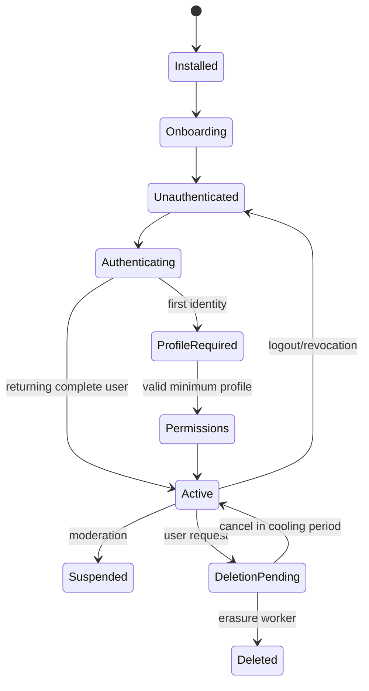

# Authentication and account lifecycle

## Providers

Primary: **Sign in with Apple**. Optional email/password only if support burden is acceptable; otherwise add passwordless email link later. Apple `sub` maps to `auth.identities`; private relay email is valid and must not be treated as disposable. Never use email as FK or stable identity.

## Session model

Supabase issues short access JWT + rotating refresh token. iOS stores refresh credential in Keychain (`kSecAttrAccessibleAfterFirstUnlockThisDeviceOnly` unless background refresh requires another documented class); access token stays memory-only where possible. Service-role key and APNs private key never ship in app. Session table/provider supports device name, created/last_seen, revoke-one/revoke-all.

## Flows

### Install → Onboarding → Registration → Profile → Permissions → Discover

1. Local onboarding version controls only educational pages, never authentication.
2. Restore Keychain session; refresh and fetch `/v1/me/bootstrap`.
3. If no valid session, Apple auth with nonce/state and PKCE/provider SDK.
4. Server transaction creates `user_profiles`, settings, audit entry; incomplete profile returns `next_step`.
5. Collect minimum profile without location. Ask notification/location permissions contextually, after explaining value.
6. Denied location: accept selected gym/city/coarse map point; discovery still works. Denied push: in-app inbox remains source of truth. Denied photos: camera/library features stay unavailable without blocking app.
7. Only `onboarding_state=complete` routes to Discover.

Reinstall: Keychain may survive uninstall, but app must call bootstrap; server state wins. A restored valid session resumes at server `next_step`. No credential means sign-in; Apple stable subject reconnects account. Deleted account gets neutral auth error or begins a new account only after deletion policy/cooling period permits.

## Endpoint/security behavior

- Auth provider endpoints are managed; application endpoints require JWT except health/legal/config.
- Email verification required before sensitive actions if email/password enabled.
- Password policy: 12+ chars, breached-password screening if available, Argon/bcrypt delegated to provider.
- Recovery response is always neutral (“If an account exists…”); no enumeration via timing/status.
- Per IP + identity/device sliding limits: login 10/15 min, recovery 3/hour, registration 5/day; add escalating cooldown/CAPTCHA at abuse threshold.
- `account_status` (`active`,`suspended`,`deletion_pending`,`deleted`) checked centrally and in RLS helper.
- Sign-out-current revokes local refresh session; sign-out-all increments/revokes all server sessions.
- Apple credential revocation/deauthorization webhook disables provider identity and initiates configured account handling.

## Error cases

| Case | Result |
|---|---|
| expired access + valid refresh | serialize one refresh; retry safe request once |
| refresh reused/revoked | wipe Keychain, `AUTH_SESSION_REVOKED`, sign-in UI |
| Apple cancellation | remain unauthenticated; no error alarm |
| duplicate callback | nonce/idempotency prevents duplicate user |
| suspended user | `403 ACCOUNT_SUSPENDED`, appeal/support path, no data access |
| deletion pending | limited status/cancel endpoints only |
| provider outage | cached signed-in UI only for non-sensitive read cache; no mutation claim |

## Account deletion/export

Re-authenticate; show consequences; enqueue request and revoke other sessions. Cooling-off (recommended 7 days) is product/legal decision. Worker deletes private media/messages per policy, anonymizes shared content where legally justified, removes Auth user last, and writes pseudonymous audit completion. Export is async encrypted archive with short-lived one-time URL.

## Tests

Apple nonce/replay, first login race, private relay email, refresh rotation/reuse, revoke device/all, enumeration timing, rate limit, suspended/deleted access, reinstall restore, offline expired session, deletion cancellation and full erasure dependency test.
