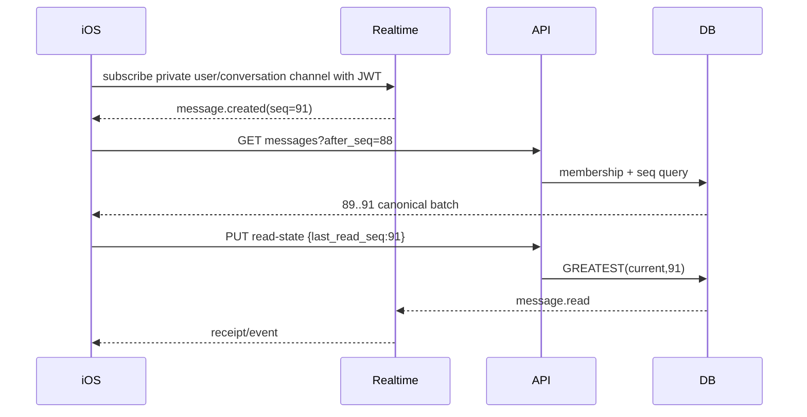

# Chat and realtime

## Guarantees

PostgreSQL is durable truth. Realtime means low-latency signal while connected; APNs is best-effort OS notification when background/offline. Neither guarantees history. Every reconnect performs cursor catch-up from API.

MVP is 1:1 conversation with canonical `direct_key = hash(min(user_id),max(user_id))` unique. Only active, unblocked users can create/send. Conversation deletion is per-member hide/archive; server records/messages remain for the other member and retention/moderation policy.

## Message identity and ordering

- Client generates UUID `client_message_id` once and persists it in offline outbox.
- Server generates `message_id` and monotonic per-conversation `server_seq` inside transaction.
- Unique `(conversation_id,sender_id,client_message_id)` deduplicates retries.
- Ordering/display uses `server_seq`, not device time.
- States on sender: `queued → sending → sent(server accepted) → delivered(optional active-device ack) → read`; `failed_retryable|failed_permanent` are client states.
- Read receipt is monotonic `last_read_seq = greatest(old,new)`; “delivered” is optional and not equivalent to read.

## Send sequence

```mermaid
sequenceDiagram
  participant S as Sender iOS
  participant API as send-message
  participant DB as PostgreSQL
  participant RT as Realtime
  participant R as Recipient iOS
  participant W as Push worker
  S->>API: POST + client_message_id
  API->>DB: lock conversation; authorize/block; insert message+outbox
  DB-->>API: message_id, server_seq
  API-->>S: 201 canonical message
  DB-->>RT: committed event
  RT-->>R: message.created
  R->>API: delivery/read cursor later
  W->>DB: claim outbox if recipient inactive
  W-->>R: APNs generic/deep link
```

Duplicate request returns the original `201` representation. Same client ID/different payload → 409. If HTTP response is lost, retry is safe.

## Receive/reconnect/read



Subscribe only to channels authorized by membership. Prefer server broadcast with private channels over exposing broad Postgres Changes. Tokens refresh and channels rejoin with exponential backoff + jitter.

## Offline

Persist conversations/messages/outbox in SwiftData/SQLite. Optimistic bubble keyed by client ID. On network restoration: refresh token; send outbox serially per conversation; reconcile by client ID; fetch after last sequence; then upload read cursor. Never silently discard attachment. Permanent validation/block errors mark message failed with action.

Attachments use private upload intent before message send; message references only `media_object status=ready`. Image encryption at rest/provider, signed URL 5 minutes, membership checked on every issuance.

## Presence and typing

Ephemeral only, TTL ~30–60 seconds, coarse `online/recently_active/offline`; opt-out supported. Typing broadcast throttled ≤1/2s and expires after 5s. No database history and no push. Current hardcoded `User.isOnline` must be removed from authoritative domain.

## Abuse, deletion and edge cases

Non-connections may send at most one request message until accepted (product choice). Block transaction prevents future sends, subscriptions and media URL issuance; hides thread locally. Sender deletion shows “Deleted user”; message erasure/anonymization follows policy. Rate limits per user/conversation/IP; max text 4k; attachment quotas.

## Tests/scale

Duplicate/reordered events, lost response, reconnect gap, refresh during socket, two-device reads, block/send race, sequence contention, APNs retry, revoked media URL. Load test connections and fan-out; Supabase Pro default includes 500 peak connections and 500 messages/s, higher limits require no spend cap/support/configuration: [Realtime limits](https://supabase.com/docs/guides/realtime/limits).
