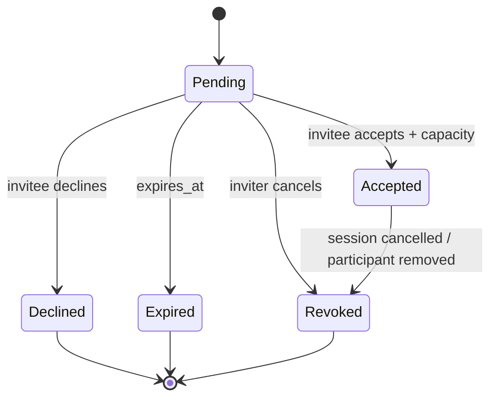
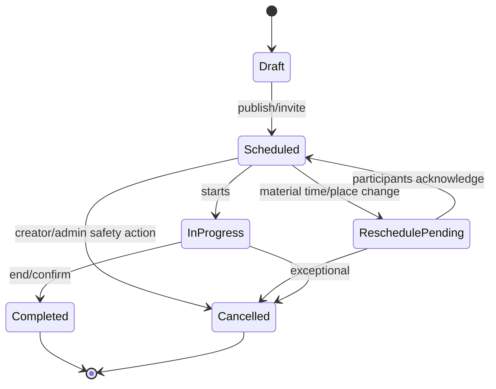

# Discover, location and workouts

## Nearby discovery

Server input: authenticated user, radius, interests, preferred time, optional gym/gender/age filters and opaque cursor. Eligibility always precedes ranking: active + adult, onboarding complete, discoverable, recent valid location or selected gym/city, not self, not blocked either direction, not already passed within cooldown, no moderation restriction.

PostGIS query uses `ST_DWithin(candidate.point, requester.point, radius_m)` and `ST_Distance` only server-side. API returns distance bucket/rounded km (for example 2 km) and general area/gym, never candidate coordinates, geohash or raw accuracy. Location is private, encrypted/provider protected, TTL and replace-on-update. Minimum useful accuracy and max update frequency reduce spoofing/cost.

No always-on location is required. Accept “while using app” one-shot refresh; alternatively selected gym/city centroid. Denial keeps manual discovery. Do not request background location in MVP.

Compatibility score: interest overlap 40%, preferred time 25%, experience compatibility 15%, same/near gym 15%, profile completeness 5%; include random tie-break/daily salt and diversity. It is explanation-friendly, not “match probability.”

Actions `pass|connect|hide` are idempotent. A pass cools down 30 days; hide indefinite. MVP “connect” can open a message request immediately; if mutual model is desired later, add `pending/accepted` connection state without changing safety checks.

## Invitation state machine

Only invitee accepts/declines; inviter may revoke pending. Transition uses version and row lock; terminal states cannot revert. Duplicate transition returns current state.

## Session state machine

Store `starts_at` UTC and IANA `timezone`; render locally. DST invalid/ambiguous input requires explicit offset resolution. Capacity includes accepted participants and is checked with `SELECT ... FOR UPDATE`; waitlist is future.

Reschedule creates revision with old/new values; materially affected participants return to confirmation state. Reminders at 24h/2h use outbox dedupe key `(session,revision,user,offset)`. Past sessions are immutable except notes/moderation correction.

Blocking any participant: immediately stop direct communication/discovery. For 1:1 session, cancel and notify generically. For future group sessions, remove blocker/blockee visibility safely or escalate host policy; never reveal who blocked whom.

## Errors and tests

`409 SESSION_FULL`, `409 INVITATION_TERMINAL`, `410 INVITATION_EXPIRED`, `422 INVALID_LOCAL_TIME`, `403 RELATIONSHIP_BLOCKED`. Test simultaneous final-seat acceptance, accept-vs-cancel, reschedule reminder dedupe, timezone/DST, expired location, spoofed radius, bilateral blocks and exact-coordinate leakage.
