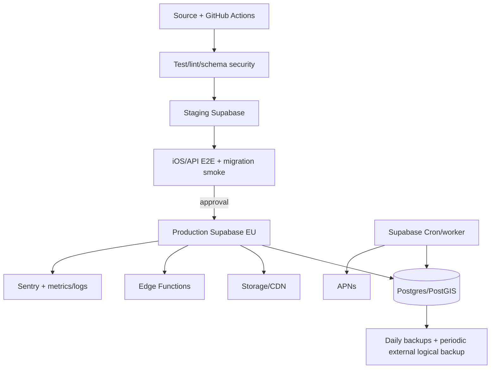

# DevOps and infrastructure

## Environments

Local Supabase CLI/container stack; separate staging and production Supabase projects in EU; separate Storage buckets, Auth URLs, APNs sandbox/production and Sentry environments. No production data copied to lower environments; synthetic fixtures only.

## CI/CD

PR: format/lint, Swift tests when available, SQL lint, migration-from-empty and upgrade test, RLS tests, Edge unit/integration, OpenAPI validation/backward-diff, secret/dependency scan. Merge: deploy staging migration/functions, smoke/E2E. Production: manual approval, backup confirmation, expand-first migration, functions, feature flag, smoke, monitoring. Rollback functions/app; DB uses forward fix, not destructive rollback.

## Secrets

Provider secret store/GitHub environment secrets; local `.env` ignored. Inventory without values: [ENVIRONMENT.md](ENVIRONMENT.md). Rotate APNs/Auth/service keys; least-privilege CI OIDC where possible. No secrets in docs/logs/mobile bundle except publishable client key.

## Jobs

Transactional outbox workers: push, emails, media processing callbacks, reminders, counters, orphan cleanup, export/deletion. Claim with `FOR UPDATE SKIP LOCKED`, lease, bounded exponential retry, dead-letter and alert. Edge Functions suit short I/O; CPU-heavy image transforms use a small container worker when needed.

## Observability/SLO

Structured JSON: request_id, actor pseudonym, route, status, latency, release; never tokens/body/location. Metrics: request p50/p95/error, DB CPU/connections/slow queries, realtime connections/events, outbox age/dead letters, APNs results, storage/egress/cost. Sentry for iOS/functions with PII scrub.

Initial SLO: API availability 99.9%; message durable acceptance p95 <500 ms; feed p95 <500 ms; push dispatch p95 <60 s (not device delivery); recovery point ≤24h and recovery time ≤4h until PITR purchased.

## Backup/DR/incident

Supabase Pro daily backup retains 7 days. Add monthly restore drill to isolated project and encrypted logical backup outside primary account; enable PITR when RPO demands justify its listed add-on cost. Runbooks: compromised key, DB saturation, auth outage, storage exposure, abusive spike. Severity, commander, communications, containment, evidence, recovery and blameless review. Quarterly restore and key rotation.

## Health

`/health/live` process only; `/health/ready` DB/storage dependency with no sensitive details. Synthetic canary signs in, reads feed and sends a test notification in staging.
