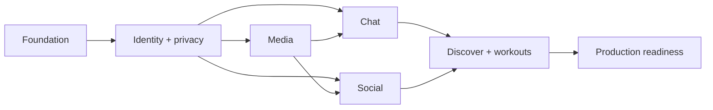

# Implementation roadmap

## Sequence and critical path

Recommended order adjusts the supplied phases: privacy/block primitives and media contract begin with Identity; chat precedes full discover matching because safe connection/message semantics are prerequisites.

Critical path: F01→F03→I01→I03→C01→C03→W01→W03→P01→P04.

## Backlog summary

| ID | Task | P | Depends | Size | Definition of Done / test / result |
|---|---|---|---|---|---|
| F01 | Repo backend layout, envs, ADRs | P0 | — | M | local stack reproducible; smoke; skeleton |
| F02 | OpenAPI/error/idempotency conventions | P0 | F01 | M | lint + examples; contract tests; client seed |
| F03 | SQL schema/migrations/RLS harness | P0 | F01 | L | clean+upgrade migrate; negative RLS; DB foundation |
| F04 | CI/CD/secrets/observability baseline | P0 | F01 | M | staging auto, prod approval; scan/smoke; pipeline |
| I01 | Apple Auth/session/bootstrap | P0 | F02,F03 | L | new/return/revoke/reinstall tests; identity |
| I02 | Profile/settings/interests | P0 | I01 | M | version/privacy validation; API/UI slice |
| I03 | Block/report/account status | P0 | I01 | L | bilateral matrix/races; safety base |
| I04 | Export/delete/session management | P0 | I01,F04 | L | erasure/export drills; GDPR lifecycle |
| M01 | Upload intent/private storage | P0 | I01 | M | path/type/quota tests; secure upload |
| M02 | Validate/variants/cleanup | P0 | M01 | L | malicious corpus/GC; ready media |
| S01 | Post/recipe/workout CRUD | P0 | I02,M02 | L | transaction/version tests; publishing |
| S02 | Feed/pagination/search | P0 | S01,I03 | L | eligibility/load/cursor; discoverable feed |
| S03 | Likes/saves/comments | P0 | S01 | M | dedupe/counter/rate; interactions |
| C01 | Conversation/member/read schema | P0 | I03 | M | membership RLS; inbox/history |
| C02 | Idempotent send/attachments/outbox | P0 | C01,M02 | L | lost response/order/block race; durable chat |
| C03 | Realtime/reconnect/offline cache | P0 | C02 | XL | duplicate/gap/process kill; live chat |
| C04 | APNs devices/worker/preferences | P0 | C02,F04 | L | sandbox/multi-device/410; notifications |
| W01 | PostGIS location/discover | P0 | I02,I03 | L | leakage/index/filter tests; nearby people |
| W02 | actions/connection requests | P0 | W01,C01 | M | idempotency/abuse; safe connect |
| W03 | session/invitation state machine | P0 | W02,C04 | XL | capacity/timezone/race; workouts |
| A01 | Admin roles/report queue/audit | P0 | I03,F04 | L | MFA/role/evidence tests; moderation |
| P01 | Full security/threat remediation | P0 | all features | L | no high findings; release security |
| P02 | load/cost tuning | P1 | S02,C03,W03 | M | 2× forecast SLO; capacity report |
| P03 | backup/restore/incident drills | P0 | F04,I04 | M | RPO/RTO met; runbooks |
| P04 | E2E/TestFlight/release gate | P0 | P01-P03,A01 | L | critical suite pass; releasable build |

Detailed executable tasks and acceptance checks: [BACKEND-TASKS.md](BACKEND-TASKS.md).
